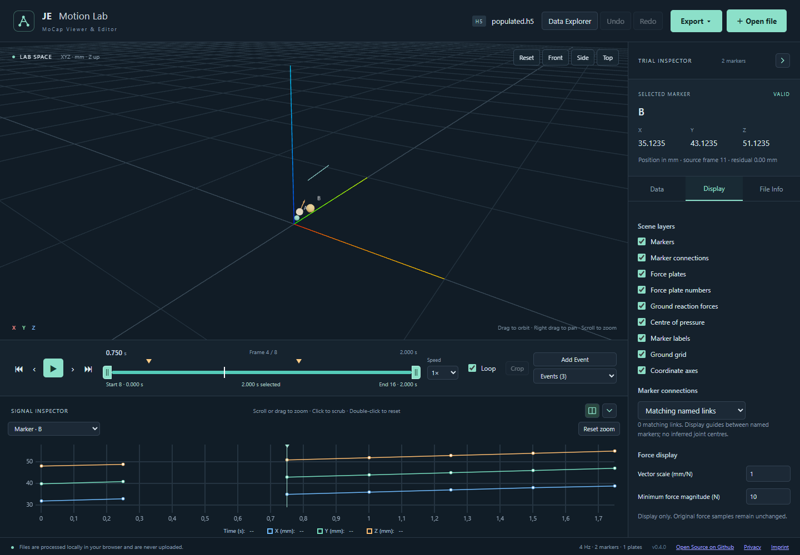
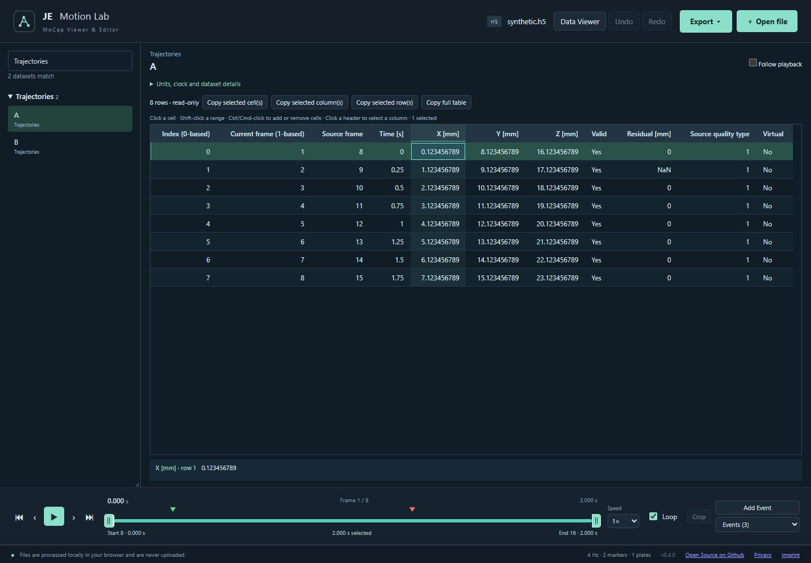

# JE Motion Lab

**MoCap Viewer & Editor**

A browser-based motion capture viewer and editor for biomechanics researchers and technically interested users. Inspect recordings in 3D, compare synchronized signals, rename data labels, delete marker trajectories, edit events, crop trials, and export results as C3D or the institute-specific H5 schema with a compatibility review before conversion.

Visit the [project website](https://jemolab.com/) or [open JE Motion Lab](https://app.jemolab.com/). The app is hosted on GitHub Pages at its custom domain; the project website is maintained separately.

**Motion-capture files are processed entirely locally in the browser. Files are not uploaded to a server.** JE Motion Lab sends anonymous usage events for application loads and successful C3D/H5 loads to a Cloudflare Worker for aggregate country statistics in D1. Analytics payloads contain only an event type, never MoCap files, filenames, labels, metadata or measurements. Normal network information is still visible to hosting and Cloudflare; see [Privacy](#privacy) for the scope and backend verification limits. There are no remote fonts or runtime CDN dependencies.



The viewer screenshot is a historical capture whose footer displays `v0.4.0`. The prepared application version is `v0.6.1`, pending publication; the published baseline remains `v0.6.0`. See the [v0.6.1 changelog](CHANGELOG.md#061---2026-10-29) and [release process](docs/RELEASING.md).

## Basic usage

1. Open the application and choose **Open file** or drop a recording anywhere. On the empty landing page, **Load Example File** downloads `example_data.h5` and opens it with the same H5 importer; nothing loads automatically. Downloading and importing can be cancelled, and errors allow retrying. The example uses the same viewing, editing, cropping and export workflows and format guards as local files. One recording is loaded at a time; a failed import leaves the previous trial available.
2. The camera automatically fits a representative valid pose after loading. Orbit, right-drag to pan and zoom; movement stops immediately when input ends. Reset and front/side/top views fit the current pose. Select a marker and press **C** to center the orbit on its current valid position. Playback, scrubbing and panel resizing preserve camera navigation. The Trial Inspector identifies the trial and available subject metadata. Its Data tab controls marker selection/visibility; Display controls scene layers and force display. Review import notes before interpreting data; dismissing a note hides the banner, not the underlying limitation or export warning.
3. Play, step or scrub the timeline. Select a signal in the Signal Inspector; use **Split plots** for two independent selections sharing the playback cursor.
4. Click a timeline event to edit it, or use **Add Event** and the Events selector beside Apply crop at the right of the timeline. New events use the current playback position. Supported fields depend on the source format.
5. In **Data**, double-click any marker, analog, force-platform, rigid-body, EMG, IK or ID label (or use its pencil) to rename it. Right-click a 3D marker for Focus, Rename and Delete; Delete removes its entire trajectory as one undoable action. The last marker and unsupported source dependencies are protected. Clicking an event seeks to its frame and opens the timeline event editor. Header **Undo / Redo** covers marker deletions, label renames and committed event edits; text inputs keep native undo.
6. Drag the timeline's start/end handles, preview the interval and choose **Apply crop**. Returning both handles to the full current working range cancels only the provisional selection, just like **Cancel crop**; previously applied crops remain applied. Open **Export** next to **Open file** and choose **Export C3D** or **Export H5**. The source format is listed first; conversion shows **Will export**, **Changed or omitted** (changes first) and any blocking errors. Partially imported C3D files show this review for both formats. **Restore original** discards crops, marker deletions, label renames and event edits; the source file remains unchanged. Cropping clears undo/redo history.
7. Use the header's **Data Explorer** button to inspect numerical tables and metadata; **Data Visualizer** switches back to 3D. Both buttons remain in the header. **Details** opens dataset metadata over the table. The **Copy** menu offers selected cells, columns, rows and the full table at stored precision. Click numeric signal headers to plot complete time series in the shared Signal Inspector; Ctrl/Cmd toggles columns, Shift selects a range, and Ctrl/Cmd+Shift adds a range. Workspace plot choices persist separately. See [Data Explorer](docs/DATA_EXPLORER.md) for selection, clocks and copying.
8. Open **Export media** beside the camera controls. **Export image…** creates a PNG at viewport, 1920 × 1080 or 3840 × 2160 resolution. **Export video…** creates a browser-local WebM of the current recorded sample span, including applied crops, at 30/60 fps and 1×, 0.5× or 0.25× speed. Both offer the optional JE Motion Lab watermark. Video depends on runtime encoder support; image export remains available. See [image export](docs/IMAGE_EXPORT.md) and [video export](docs/VIDEO_EXPORT.md).



The Data Explorer screenshot is a historical `v0.5.0` capture with synthetic test data.

## Development setup

Use Node.js 22.12+ (Node 24 recommended).

```sh
npm ci
npm run dev
```

Open the local URL printed by Vite, normally http://127.0.0.1:5173. On Windows PowerShell where `npm.ps1` is disabled, use `npm.cmd ci` and `npm.cmd run dev`; no execution-policy change is needed.

## Features

- [Data Explorer](docs/DATA_EXPLORER.md): a wide, read-only workspace for numerical marker, analog, force-platform, event, rigid-body, EMG and IK/ID inspection, structured metadata, dataset search and exact-value copying. Tables use bounded row windows; H5 model variables load local sample pages on demand.
- Inline relabeling for all non-event Data-tab collections, including generated trajectory names, with validation and C3D/H5 round trips. Events use their existing editor. Undo/redo retains up to 100 marker-deletion/label/event actions: **Ctrl/Cmd+Z**, **Ctrl/Cmd+Shift+Z**, or **Ctrl+Y** to redo on Windows. See [data labels and history](docs/DATA_EDITING.md) for identity, connections, format limits and lifecycle rules.
- Data Visualizer offers **Split plots** for two independent signal selections and zoom ranges, including IK/ID. Data Explorer reuses the same chart for selected numeric columns across the full underlying series. Both follow the playback cursor; clicking a plot scrubs the recording. Crop preview de-emphasizes samples outside the selected interval without changing data. On narrow windows, the split area scrolls horizontally.

- Local `.c3d`, `.h5`, and `.hdf5` loading in a cancellable Web Worker.
- Shared format-independent 3D viewer and playback for both formats.
- Instanced markers, missing-sample handling, residuals, selection and individual visibility. A 12 CSS-pixel picking radius helps select small visible markers without enlarging their scientific geometry; ambiguous misses preserve selection. The Viewer suppresses the browser context menu and retains the custom marker menu. The [Data sidebar](docs/DATA_BROWSER.md) browses available MoCap collections with counted sections, cross-category search, plot selection and event seeking/editing.
- Named marker connection presets for the inspected IBO sets and Plug-in Gait; selectable or disabled. These are display links, not an anatomical model.
- Static and time-varying force-platform geometry, global ground reaction force (GRF) arrows originating at the centre of pressure (COP), and COP points where coordinate conventions are established.
- Force types 2, 3 and 4, including 6×6 calibration and type-3 COP polynomial correction.
- Optional [local coordinate systems](docs/LOCAL_COORDINATE_SYSTEMS.md) for force platforms and rigid bodies in **Display**, independently toggled and on by default. Small red/green/blue XYZ axes follow stored poses without changing data or edit history; visible helpers also appear in image/video exports.
- Automatic camera fitting after load, fixed marker focus, orbit, pan, zoom, reset, front, side and top views; Z-up lab axes and ground grid. Global XYZ axes retain their 500 mm length with a 20 mm world-space width, become thinner with distance and stay visible over the grid and plates. Their visibility is controlled separately from local coordinate systems. Fitting uses valid geometry from one representative pose, with bodies/plates as fallbacks, rather than the full movement envelope.
- **Export media** groups high-resolution [PNG image export](docs/IMAGE_EXPORT.md) and browser-local [video export](docs/VIDEO_EXPORT.md) in separate workflows. Both export only the scientific 3D scene and offer an optional JE Motion Lab watermark. Video uses runtime-supported VP9/VP8 WebM encoding with explicit physical timestamps.
- Playback at the declared point sampling rate, with scrubbing, stepping, beginning/end, speed and loop controls.
- Non-destructive timeline cropping, range preview, restoration and local **Export** as C3D or institute H5. Source-format exports preserve the original representation; [cross-format export](docs/CROSS_FORMAT_EXPORT.md) reports incompatible clocks, omitted data and precision changes before exporting. See [crop conventions and export limits](docs/CROPPING_EXPORT.md).
- Synchronized marker XYZ, force, moment, COP, optional free moment and analog plots, plus institute H5 EMG and rigid-body position signals when present. Scroll up/down over the plot to zoom in/out around the pointer, or drag horizontally to select a zoom range. Click to scrub; double-click or use **Reset zoom** to restore the full time range.
- Desktop separators resize Trial Inspector width, Signal Inspector height and Split Plot widths. Arrow keys adjust focused separators (Shift for larger steps); Home or double-click resets. Collapse/Expand restores custom sizes, and workspace dimensions remain in memory while switching. Explorer's empty Signal Inspector is compact and restores its preferred expanded height when plotting resumes.
- C3D and current institute H5 timeline events with add/edit/delete, format-supported text fields, crop-aware export and restoration. Left/Right events use upper/lower lanes; General events use yellow diamonds in available space. **Compact event markers** in Display defaults off and switches to one lane; local collisions open selectable event clusters. [Event editing](docs/EVENT_EDITING.md) describes timing and confirmation. [File Info](docs/FILE_INFO.md) groups recording/acquisition facts, data counts and available subject, project and location metadata; raw source trees stay internal. Import notes can be dismissed individually or together for the current recording; a new import shows them again.
- Explicit scientific units: positions/residuals/COP in mm, force in N, moments in Nm. See the [unit policy](docs/UNITS.md) for import/export boundaries and rendering scale. Display arrow scale defaults to 1 mm/N; threshold defaults to 10 N and changes display only.

## Keyboard shortcuts

Open **Keyboard shortcuts** (keyboard icon) in the header for the in-app reference,
including focus-specific Timeline, Explorer and panel-resizing controls.
Tab stays within the reference; Escape or Close dismisses it and returns focus to
the trigger. Application shortcuts are inactive while it is open.

| Shortcut                   | Action                                                                            |
| -------------------------- | --------------------------------------------------------------------------------- |
| Space                      | Play/Pause                                                                        |
| ← / →                      | Previous/next frame; pauses playback                                              |
| Home / End                 | First/last frame                                                                  |
| C                          | Focus selected marker's current valid position; pivot stays fixed during playback |
| F                          | Fit/reset the scene                                                               |
| Ctrl+Shift+U               | Rename selected marker                                                            |
| Delete                     | Delete selected marker's complete trajectory, where supported                     |
| Shift+F10                  | Open selected marker's context menu                                               |
| Ctrl/Cmd+Z                 | Undo                                                                              |
| Ctrl/Cmd+Shift+Z or Ctrl+Y | Redo                                                                              |
| Escape                     | Dismiss the active menu/Details; leave Explorer when no local editor consumes it  |

Marker/camera commands require the active Data Visualizer. Text inputs,
contenteditable elements, dialogs, Event Editor, plots, Explorer tables and resize
handles keep their own keyboard behavior. Explorer's Ctrl/Cmd+C copies exact
selected cells; highlighted browser text retains native copying. See
[marker controls and shortcut scope](docs/DATA_EDITING.md#marker-interaction-and-keyboard-controls).
The timeline shows ordinal frames starting at 1; Explorer also exposes source
frames and normalized scientific coordinates. Recording end time is the last
sample timestamp, `(frames - 1) / rate`; crop's exclusive boundary is `frames / rate`.

## Supported formats and limits

| Format       | Supported                                                                                                                                                                                                           |
| ------------ | ------------------------------------------------------------------------------------------------------------------------------------------------------------------------------------------------------------------- |
| C3D          | Intel little-endian and MIPS big-endian; integer and IEEE float point records; parameter labels and continuation labels; scaled signed/unsigned analogs and subframes; residual validity; events; force types 2/3/4 |
| Institute H5 | `Trajectories/Labeled/Data [marker,4,frame]`, Labels and SamplingFrequency; optional analogs/force groups; compressed HDF5; current unversioned authoritative schema only                                           |

Optional current-H5 data groups such as EMG may be omitted or empty when no data
were recorded. Available data remain strictly validated for dimensions and
metadata; empty categories are hidden without placeholder channels or warnings.
Required trajectories and the current nested metadata layout remain required.
See [empty H5 semantics](docs/H5_FORMAT.md#absent-and-empty-optional-data).

DEC/VAX C3D encoding is rejected. A verified separate 17-float Rotation extension, as found in the supplied Xsens examples, permits **partial import** of Point/Analog data. Rotation poses and reliability values are omitted and disclosed in dismissible import notes and mandatory export previews for both formats. Dismissing notes does not remove the import limitation or export disclosures. Supported data remain exportable; C3D output removes Rotation records and metadata. Unknown, inconsistent or truncated layouts still fail explicitly. See [Rotation compatibility](docs/PARSERS.md#separate-rotation-extension-partial-import). Unsupported force-platform types are reported and omitted, while marker and analog data remain accessible. Other HDF5 schemas are not supported. C3D interoperability includes synthetic Intel/MIPS variants and historical independent local comparisons; optional private references are not part of the portable test suite. This does not establish compatibility with every vendor or reader.

Sampling rate follows the source metadata. The provider confirmed that particular Xsens examples declare 240 Hz despite 60 Hz acquisition; those files need upstream metadata correction. JE Motion Lab applies no automatic rate correction, effective-rate override or resampling. Playback speed changes viewing speed only. `QTM_Example.c3d` is a separate Qualisys example, not an Xsens reference.

The current H5 declares global force vectors. Unresolved force frames remain available for signal inspection, but require explicit confirmation of stored-global coordinates for spatial force display. Missing marker or rigid-body units fail explicitly. Current institute H5 supports nested project/file provenance, expanded event context/subject metadata, explicit clocks, mapped EMG, rigid-body data and quality flags; obsolete institute H5 layouts are rejected. Data lists IKResults and IDResults variables, with counts in File Info; labelled time rows are excluded. Model values are available in Data Explorer through local sample pages, and can now be selected in Data or either Signal Inspector pane for plotting. Each source column is scalar and retains its units and physical model clock; matching trajectory clocks are recognized as aligned and cropped with the trial. Independent results retain their original model clock and samples. Their source data remains available for source-format export; cross-format C3D output reports IK/ID omission. Type codes and unprovided coordinate conventions are not guessed. See [H5 format](docs/H5_FORMAT.md) and [open questions](docs/OPEN_QUESTIONS.md).

No general trajectory editing, scientific filtering, inferred joint centres, gait-event detection, audio, or persistent file storage is included. Marker timelines must be present. Mobile is secondary. Video export is limited to a 1080p pixel count, two minutes and 64 MiB; available encoders depend on the browser/device. Large file limits depend on browser memory. There is no service worker yet: a cached tab can keep working, but reliable offline reload/PWA installation is not claimed.

Use a modern browser with WebGL, WebAssembly and module worker support. Google Chrome, Microsoft Edge, Safari and Samsung Internet / Samsung Browser have been extensively **manually tested**. Automated Playwright smoke coverage targets Chromium through Chrome, with an Edge option; it does not cover Safari, Samsung Internet or Firefox. No universal browser compatibility is claimed. Hardware acceleration is recommended for 3D rendering.

Same-format exports preserve source values rather than writing normalized display coordinates. Unchanged exports of complete imports return the original bytes; partially imported C3D exports always omit Rotation records after review. Modified exports have format-specific limits: C3D event editing supports up to 255 events, force-baseline intervals must survive cropping, and unknown H5 time-dependent datasets or unsupported storage types may block modified export. H5 marker clocks must be regular; other supported signal clocks may be irregular. Rigid-body rotations remain structured data and can be inspected with optional local axes; source parent-frame conventions remain unverified, and no anatomical skeleton is inferred. See [local frame conventions](docs/LOCAL_COORDINATE_SYSTEMS.md), [cropping/export limits](docs/CROPPING_EXPORT.md), [event editing](docs/EVENT_EDITING.md) and [H5 validation](docs/H5_VALIDATION.md).

C3D data labels support up to 255 UTF-8 bytes; H5 labels have no application-imposed length limit. Force-platform names round-trip in JE Motion Lab through an optional C3D `FORCE_PLATFORM:LABELS` parameter; other readers may still display platform numbers. Renaming markers retains existing preset connections within the session; re-import resolves presets against the exported names. Cropping clears undo/redo; exporting preserves history and the Modified indicator because the original loaded file remains the baseline.

## Architecture

The application is a static TypeScript/React site built with Vite. Three.js, React Three Fiber, and drei provide 3D rendering; Zustand holds session state; uPlot renders signals; and h5wasm reads and writes HDF5 locally. A separate Cloudflare Worker receives anonymous usage events for aggregation in D1; motion-capture data remain entirely local. The Worker and database are managed outside this repository; see [analytics architecture and verification scope](docs/ANALYTICS.md).

```text
local File → Worker → C3DImporter / H5Importer → MotionData
                                                 ├─ shared 3D scene
                                                 ├─ timeline / playback
                                                 ├─ synchronized plots
                                                 └─ inspector
```

`MotionData` contains contiguous typed arrays with validity, original-rate signals, explicit units, independent geometry timing and provenance. Scene objects share one normalized render path; local-frame helpers require a declared pose or an established source corner convention. Workers transfer buffers back and terminate to release parser/WASM memory. The small timeline subscribes to frame changes; 3D buffers and plot cursor update imperatively.

| Location                                           | Responsibility                                                                    |
| -------------------------------------------------- | --------------------------------------------------------------------------------- |
| `src/importers/`, `src/exporters/`, `src/workers/` | Format parsing, source-preserving export, semantic conversion and workers         |
| `src/motion/`                                      | Shared data model, timing, crop, marker deletion, label/event edits and undo/redo |
| `src/state/`, `src/playback/`                      | In-memory session and playback clock                                              |
| `src/viewer/`, `src/plots/`, `src/components/`     | 3D scene, Signal Inspector, timeline and editing controls                         |
| `src/layout/`, `src/explorer/`                     | Panel geometry and accessible separators; dataset catalogs, selection and copy    |
| `tests/`, `scripts/`, `docs/`                      | Synthetic fixtures, validation tools and technical documentation                  |

See [architecture](docs/ARCHITECTURE.md), [parser decisions](docs/PARSERS.md), and [validation](docs/VALIDATION.md).

Cross-format export creates a fresh file from imported, edited/cropped data and can be lossy. H5→C3D requires aligned point/analog grids and uses float32 storage. Compatible stationary plates reuse validated original TYPE-2/3/4 definitions and existing analog channels when embedded metadata is available; otherwise each plate uses a derived six-axis TYPE-2 fallback. Accepted surveyed corners retain their coordinates/order without a geometry warning. Differing stored COP/free moment is reported and omitted only when the chosen representation cannot reproduce it. Imported subject/project/file/location and coordinate descriptions are retained in documented `JE_METADATA` parameters, which other readers may not display automatically. Rigid bodies, IK/ID, trajectory Type/Virtual/camera fields and unrelated raw trees are omitted. C3D→H5 writes the current institute schema with normalized values and a limited subject/provenance mapping. Review the [four export paths and compatibility matrix](docs/CROSS_FORMAT_EXPORT.md) for exact limits; conversion is not lossless.

## Tests and production build

```sh
npm test
npm run typecheck
npm run build
npm run format:check
npm run preview
```

`dist/` is a completely static application. Use HTTP hosting rather than opening index.html as a `file://` URL, because module workers require an appropriate origin.

Scientific tests cover units, frame/time mapping, gaps, binary C3D variants, compressed HDF5, force transformations/calibration/COP and malformed input. Editing regressions cover all label collections, unchanged scientific arrays, undo/redo, dirty-state transitions, source identity and C3D/H5 round trips. Synthetic fixtures contain no participant data.

Optional local C3D comparisons skip when the ignored `.local/reference.json` oracle or its source recordings are unavailable. Available-input numerical failures remain failures. Regenerate a stale oracle on a machine with the originals and report skipped private comparisons separately; do not commit the oracle or recordings.

With Chrome installed, run the browser and privacy smoke check after building:

```sh
npm run test:browser
```

For Microsoft Edge, set `BROWSER_CHANNEL=msedge`. This check exercises the demo download/import, cropping/export, base-aware asset URLs and byte-identical production H5 asset, plus viewer controls using synthetic C3D/H5 test fixtures, error recovery, the footer version, request URLs/methods/bodies and browser storage. Analytics requests are intercepted locally to validate event-only payloads without affecting live counts; the check does not validate the deployed Worker or D1. Reports and screenshots stay under ignored `.local/`. Focused development-server checks run with `node scripts/browser-camera.mjs` (including marker controls/deletion), `node scripts/browser-workspace-resize.mjs`, and `node scripts/browser-explorer-polish.mjs`. The full smoke script uses the production build by default; these focused scripts use local development probes. See [validation coverage](docs/VALIDATION.md).

Optional local numerical comparison requires Python with ezc3d/numpy and explicit local C3D paths, supplied directly or as an ignored JSON array in `.local/reference-inputs.json`:

```sh
python scripts/reference-export.py --manifest .local/reference-inputs.json
npm run validate:reference
```

This Python script is a development oracle, never a backend or application dependency. It reads the originals without modifying them and writes only ignored local output.

For independent cross-format comparisons of generated synthetic files, run `python scripts/validate-cross-format.py` after the conversion tests in an environment with numpy, h5py and ezc3d. The opt-in authoritative H5 check and other local validators are documented in [validation](docs/VALIDATION.md); these Python tools are not application dependencies.

## GitHub Pages

The included [workflow](.github/workflows/deploy.yml) runs `npm ci`, tests, `format:check` and the typechecked production build. Pushes to `main` deploy only `dist/`; pull requests run checks without deploying. Manual workflow runs deploy only when run on `main`. In **Settings → Pages**, choose **GitHub Actions** as the deployment source. No custom secrets are needed for Pages. This workflow does not deploy the analytics Worker, configure D1 or run the browser smoke check.

The workflow explicitly builds with `VITE_BASE_PATH=/` for the custom app domain, `app.jemolab.com`. Configure that domain in **Settings → Pages → Custom domain**; the separate static landing page at `jemolab.com` is not deployed by this workflow. For a matching local build:

```powershell
$env:VITE_BASE_PATH = '/'
npm.cmd run build
```

Outside CI, the default base is relative (`./`). For a deployment under a repository path, explicitly set `VITE_BASE_PATH` to that path (for example, `/mocap-web-viewer/`) and adjust the workflow too; it does not read a repository Actions variable. The application HTML declares `https://app.jemolab.com/` as its canonical URL. Private source measurements, local comparison output, and node_modules are ignored; the intentionally public sanitized demo is the sole recording included in the build; do not add private files to `public/`, because that directory is copied to the deployed site.

## Privacy

The demo source is `reference-data/example_data.h5`. Vite emits this exact file as a separate static asset using `?url&no-inline`, following `VITE_BASE_PATH` in development and production; H5 bytes are never bundled into JavaScript. Other recordings remain ignored and are not included in the build. Retained subject identifiers have been replaced with generic test subjects, recording timestamps removed and source paths replaced with the demo filename; measurement arrays are preserved. Review all metadata and obtain clearance for public distribution before replacing the demo. The demo downloads only after a click and is processed locally, with the same single anonymous `h5_loaded` event as a local H5 import.

The application footer links to [Privacy](https://jemolab.com/privacy.html) and [Imprint](https://jemolab.com/imprint.html). These external pages are the single source of truth for the privacy policy and legal notice. The information below documents the application's technical behavior.

Motion-capture files remain on your computer and are processed locally in browser workers. MoCap files, filenames, labels, source metadata and measurements are never sent to analytics. Imports and edits live in memory, file conversion and export happen locally, and the application does not persist recordings in browser storage. Export requires explicit user action.

JE Motion Lab sends a JSON body containing only `{"event":"visit"}`, `{"event":"c3d_loaded"}` or `{"event":"h5_loaded"}` to `https://je-motion-analytics.jonasebbecke97.workers.dev/event`. The `visit` event is sent once whenever the application mounts; reloading the page therefore generates another visit event. This metric represents application loads, not unique visitors or sessions. Each successful C3D or H5/HDF5 import sends a load event, including repeated loads of the same file. Failed or cancelled imports do not send load events. Analytics does not use cookies, sessionStorage, localStorage, IndexedDB, Cache Storage, persistent identifiers or browser fingerprinting. Analytics is also enabled during local development and preview. Failed requests are not retried and never interrupt application use, so counts may be incomplete.

The documented backend design uses a Cloudflare Worker to derive approximate country from Cloudflare request information and increment D1 counts by date, country and event type. Country is not read from recording metadata or sent in the application payload. The Worker source, D1 schema and logging configuration are not included here, so this repository alone cannot verify deployed aggregation, stored fields or retention. See [analytics details](docs/ANALYTICS.md).

Anonymous here means that the client creates no user/session identifier, tracking cookie or browser fingerprint. The event body includes no file size, device profile or browser information. HTTP requests still expose connection information such as IP addresses and browser-supplied headers (including browser information and the CORS `Origin`) to the receiving infrastructure. The page sets `no-referrer` to suppress the `Referer` header; it does not conceal the IP address or CORS origin. Hosting and Cloudflare may process or log connection information; this is not a guarantee of anonymity at the network level or of log deletion.

The web app at [app.jemolab.com](https://app.jemolab.com/) does not retrieve or display aggregate analytics statistics. The separately maintained landing page at [jemolab.com](https://jemolab.com/) may retrieve aggregate statistics from the Worker's existing `/stats` endpoint. That endpoint and its backend fields remain unchanged.

The production CSP uses `connect-src 'self' https://je-motion-analytics.jonasebbecke97.workers.dev`. This permits connections to the application origin and the analytics **origin**; the app uses only `/event` at that origin. Development also allows local Vite WebSocket connections. Bundled scripts, styles and workers load from the application origin; JSON analytics POSTs may require CORS OPTIONS preflight requests. The CSP restricts connection destinations, not request contents; local file handling and the event-only payload keep MoCap data out of analytics.

Keep private recordings out of Git and `public/`. The existing ignore rules exclude H5/C3D recordings and local validation output; `public/` is copied into every deployed build.

## License

JE Motion Lab is source-available under the [PolyForm Noncommercial License 1.0.0](LICENSE.md).

Noncommercial use is allowed subject to the license. Modification is allowed for
purposes permitted by the license, and redistribution is allowed subject to its
terms, including preservation of the [required notices](NOTICE). The public
license does not grant commercial use. Commercial use requires a separate
commercial license from Jonas Ebbecke; use the contact details in the
[Imprint](https://jemolab.com/imprint.html). Separate commercial licenses are available exclusively to organizations and business users (B2B).

See the [official PolyForm terms](https://polyformproject.org/licenses/noncommercial/1.0.0)
and [third-party notices](THIRD_PARTY_NOTICES.md). Third-party components retain
their respective licenses.

## Citation

For scientific use, please cite JE Motion Lab using the metadata in [CITATION.cff](CITATION.cff). Scientific citation is requested for scholarly credit and is not a condition of the public license.

## Development status and releases

The latest published release is [JE Motion Lab v0.6.0](https://github.com/JEbbecke/mocap-web-viewer/releases/tag/v0.6.0), dated 2026-10-26. The prepared [v0.6.1 candidate](CHANGELOG.md#061---2026-10-29) has a confirmed publication date of **2026-10-29** and completed maintainer-confirmed manual acceptance; package, citation and generated footer versions are **0.6.1**. v0.6.1 remains unpublished pending deployment, tagging and release publication.

JE Motion Lab is under active pre-1.0 development. Support is limited to the documented formats and validated conventions; arbitrary vendor variants and general HDF5 files are not claimed. Outstanding format questions are tracked in [OPEN_QUESTIONS.md](docs/OPEN_QUESTIONS.md).

Published GitHub releases and their tags establish release history. [package.json](package.json) supplies the application version, injected at build time and shown in the footer; the lockfile matches it. See [CHANGELOG.md](CHANGELOG.md) for formal releases and unreleased changes, and [the manual release workflow](docs/RELEASING.md) for Semantic Versioning, release PRs, tags and GitHub Releases. An ordinary feature merge does not require a version bump: the package/footer retain the latest formal release version while changes accumulate under `[Unreleased]`. They advance when the next release is intentionally prepared. The Pages application follows `main` and can be ahead of the latest formal release. The historical package-version mismatch in the first GitHub release is documented in the changelog.

See [event visualization and editing](docs/EVENT_EDITING.md) for immutable event operations, relative-second timing, C3D serialization and the current institute H5 event layout. See [authoritative H5 validation](docs/H5_VALIDATION.md) for round-trip results and remaining limits.
